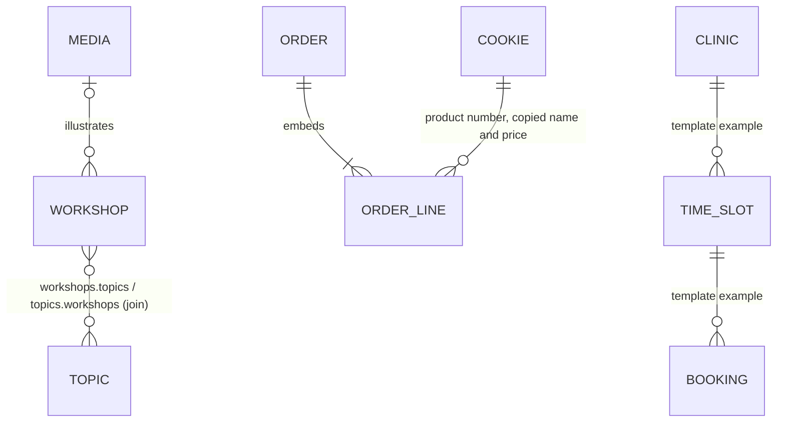

# Content and structure

Team 11 · Cookie Shop (T11-S3F8). What content the site holds and how it is organised. The [brief](brief.md) and [requirements](requirements.md) remain the sources for the two user tasks.

The collection the transactional task saves into is named in `src/course-check.config.ts`: `orders`, with the name field `name`.

## Content inventory

| Content | Where it comes from | Who keeps it up to date |
| --- | --- | --- |
| Six cookies: name, description, flavour, price, illustration key, tasting profile (sweetness, chocolate, texture, preference, caramel) | Payload collection `cookies` | Editors in `/admin`; product number and slug are fixed |
| Cookie illustration files | `public/images/workshops/`, chosen per cookie by its illustration key | Maintainer, through a pull request |
| Workshops: title, level, day, times, price, group size, summary, description, image, topics | Payload collection `workshops` | Editors in `/admin` |
| Workshop topics: name, description; the workshops of each topic | Payload collection `topics`; the workshop list is a join on `workshops.topics` | Editors in `/admin` |
| Orders: customer name and e-mail, cookie lines, total, status | Payload collection `orders`, written only by the server's order action | Created by users; read and updated by editors |
| Homepage, commercial video and its transcript | Page component and `public/` media | Maintainer, through a pull request |
| Cookie Finder rules | Code, keyed by the product numbers | Maintainer, through a pull request |
| About (with the Fortune Cookie), Contact (with the FAQ and the campus map) | Page components | Maintainer, through a pull request |
| Privacy page | CMS `pages` | Editors |
| Starter booking example: clinics, time slots, bookings, repairs | Payload collections kept from the template | Not part of the Cookie Shop tasks; kept so earlier records are not lost |

## Content model

There are six topic-specific collections. The four core collections are Cookies, Orders, Workshops and Topics. Workshop Sessions and Workshop Registrations support the optional registration flow.

| Collection (slug) | Fields | Links |
| --- | --- | --- |
| Workshop (`workshops`) | title*, slug* (unique), level*, day*, start time*, end time, price* (≥ 0), group size*, summary*, description, image (→ media), topics | many-to-many with Topic |
| Topic (`topics`) | name*, slug* (unique), description; `workshops` is a join, not a stored field | many-to-many with Workshop; a topic cannot be deleted while a workshop uses it |
| Order (`orders`) | name* (holds the team code for course checks), customer name*, e-mail*, items* (at least one line), total in cents*, status (default New), request ID (unique) | embeds Order lines |
| Cookie (`cookies`) | product number* (unique, fixed), name*, slug* (unique, fixed), description*, flavour*, price in cents* (1–100,000), illustration key*, sweetness* (1–5), chocolate* (1–5), texture*, preference*, caramel | 1 cookie – many order lines, through the product number. Anyone reads; editors change; nobody creates or deletes through `/admin` |
| Workshop Session (workshop-sessions) | start and end, capacity, confirmed places, status | links to a workshop |
| Workshop Registration (workshop-registrations) | reference, contact details, places, status and historical snapshots | links to a session and retains workshop context |
| Order line (embedded in an order) | cookie number, cookie name, quantity, unit price in cents | refers to a Cookie by its product number; name and price are copied so a receipt stays correct after an editor changes the cookie |
| Clinic, TimeSlot, Booking, Repair (template) | as in the starter | Clinic 1–n TimeSlot 1–n Booking; not used by the Cookie Shop tasks |
| Page, Media, User, Member, Throttle | generic CMS and system collections | do not count as topic collections |

\* = required.



The many-to-many is stored once, on the workshop, and read in both directions: a workshop page lists its topics and each topic page lists its workshops. On production on 24 November 2026 all four workshops and three topics linked consistently in both directions.

The order action checks the contact fields, cookie numbers, quantities and request ID, then takes each cookie's current name and price from the `cookies` collection and calculates the total itself; the browser never sends a price. Sending the same request again returns the existing receipt instead of a second order. Historical orders keep the price they were placed at.

**Collections of our own topic (at least four asked):** `cookies`, `orders`, `workshops` and `topics`. The `cookies` migration copied the six cookies with their existing numbers, words and prices. The template's `clinics`, `timeSlots`, `bookings` and `repairs` are not counted.

Workshop registration adds `workshop-sessions` (one workshop to many sessions) and `workshop-registrations` (one session to many registrations). The existing Workshop–Topic many-to-many remains. The workshop detail template contains session selection, review and confirmation, so the counted inventory stays at nine pages. The site reads a server-side projection of session times, status and remaining places. Payload collection access is editor-only and private registration records hold the historical title and time snapshots. PostgreSQL updates confirmed-place counts atomically with registration or cancellation.

The global basket is a header dialog. It opens on the current page and links to the existing checkout section at `/clinics#customer-details`. It adds no routes or CMS collections.

## Sitemap

```text
/                    Home ─┬─> /cookies, /clinics, /cookie-finder, /workshops
/cookies             Our Cookies: six cards, Taste Map, comparison (#compare-cookies) ─> /clinics
/cookie-finder       Finder and Taste Passport ─> /cookies, /cookies#compare-cookies, /clinics
/clinics             Order Cookies: choose cookies or build a four-cookie box (#build-your-box),
                     basket, test order ─> receipt on the same page; the address becomes
                     /clinics/confirmed (a confirmation, not counted as a page)
/workshops           Workshop overview ─> /workshops/[slug] ─> /topics/[slug] ─> /workshops/[slug]
/about               Our story, with the Fortune Cookie (#fortune-cookie)
/contact             Contact, campus map (opt-in) and FAQ (#faq)
/privacy             Privacy (not counted as a page)
/admin               Editors only (incl. order analytics and CSV export)
```

**Pages that count (grading list line 3: a record page counts once for its kind; only pages linked from the home page; confirmation, privacy and not-found excluded):** Home, Our Cookies, Cookie Finder, Order Cookies, Workshops, a workshop's page, a topic's page, About, Contact = **9**.

Redirects kept for old links: `/home` → `/`; `/compare` → `/cookies#compare-cookies`; `/build-your-box` → `/clinics#build-your-box`; `/faq` → `/contact#faq`; `/fortune-cookie` → `/about#fortune-cookie`; `/workshops#cookies`, `#taste-map`, `#comparison`, `#cookie-1`…`#cookie-6` → `/cookies`; the retired example clinic → `/clinics`. `/clinics/[slug]`, `/clinics/[slug]/booked` and `/account` belong to the template booking example and are not linked in the menus.

## Navigation labels

Main menu, the same on phone and laptop: **Home**, **Our Cookies**, **Workshops**, **Cookie Finder**, **About Us**, **Contact & FAQ**, and the highlighted **Order Cookies** button. The footer adds direct links to **Fortune Cookie**, **FAQ** and **Privacy**.

Why users understand them: the labels name what a shop customer looks for in plain words ("Our Cookies" for the products, "Order Cookies" for the action), like the competitor shops in our benchmark. "Order Cookies" is set apart visually because ordering is the primary task, and our usability test showed it had to be easier to find (test report, Finding 3, PR #17). The technical address `/clinics` comes from the template; users only see the label.

## Each user task, step by step

**1. Transactional — order cookies (primary)**

1. Home: choose **Order Cookies** in the hero or menu.
2. `/clinics`: add cookies with the + buttons, or fill a four-cookie box in the Box Builder section (or arrive with cookies already added from Our Cookies, the comparison or the Finder).
3. Same page, basket: check quantities and the total; change or remove lines.
4. Same page: enter a made-up name and e-mail and choose **Place test order**.
5. Same page: the receipt appears only after the server has saved the order; it can be printed.

**2. Informational — find and compare cookies**

1. Home or menu: choose **Our Cookies**.
2. `/cookies`: read the six cards (name, flavour, description, price); use the Taste Map to see sweetness and chocolate intensity.
3. Select two or three cookies to compare; the comparison section (`/cookies#compare-cookies`) shows them side by side, with differences highlighted.
4. Optionally go on to order from the comparison.

The Cookie Finder (`/cookie-finder`) is an optional route into the same task: a few questions lead to a recommendation, an alternative and links to compare or order.
