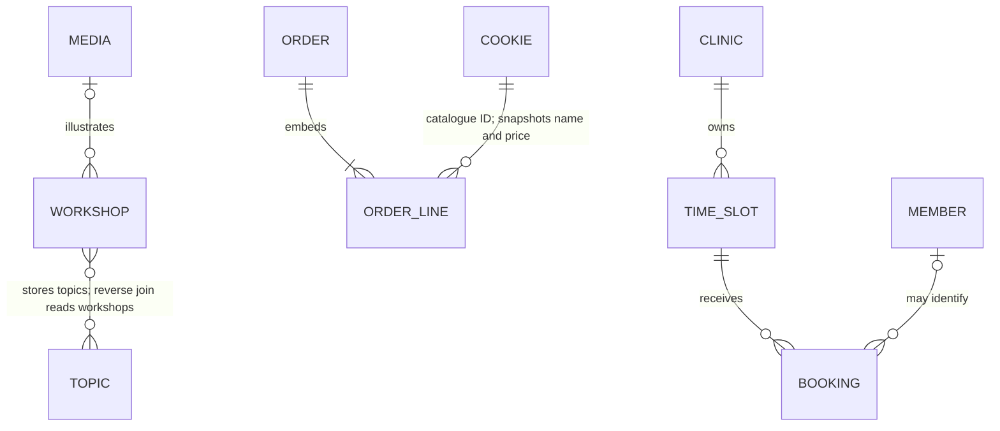

# Content and structure

Team 11 · Cookie Shop. This is a retrospective inventory of PR #27. The [brief](brief.md) and [requirements](requirements.md) remain the sources for the team's original outcomes.

## Content inventory and navigation

| Content | Source and maintenance | Route and next step |
| --- | --- | --- |
| Six flavours, descriptions, current prices and illustrations | Code catalogue in `src/content/cookies.ts` and approved resolver in `src/lib/workshop-image.ts`; maintainer | `/cookies`: title, six flavour shortcuts, six cards, Taste Map, comparison tray and order links |
| Cookie workshops and topics | Published Payload workshops and topics, maintained by editors; local illustrations resolve by workshop slug | `/workshops` → `/workshops/[slug]` ↔ `/topics/[slug]`. Topic links can open the filtered overview. |
| Home and commercial | Page copy, approved media and three workshop previews | `/`: hero, commercial, editorial journey links, workshops preview, cookie collection |
| Recommendations and comparison | Catalogue IDs, stored qualitative comparison profiles and deterministic Finder rules | `/cookie-finder` → Passport, `/cookies#taste-map`, `/compare`, `/build-your-box` |
| Cookie ordering and confirmation | Shared basket and the server-validated Payload Orders collection | `/clinics` has product selection, basket, fictional customer details and an inline printable receipt |
| About, contact and help | Site components and CMS pages where configured; editor and maintainer | `/about`, `/contact`, `/faq`, `/privacy`. The external campus map is optional and opt-in. |
| Secondary starter compatibility | Clinics, timeslots, bookings and optional member access | `/clinics/[slug]`, `/clinics/[slug]/booked`, `/account`, `/account/login` |
| Administration | Payload editor role | `/admin`, protected order analytics and CSV export |

Desktop and mobile offer Home, Our Cookies, Workshops, Cookie Finder, About Us, Contact and Order Cookies, with optional account links. The mobile menu uses the same destinations. Footer links include both Our Cookies and Workshops. Legacy `/workshops#cookies`, `#taste-map`, `#comparison` and `#cookie-1` through `#cookie-6` use the client-side compatibility redirect. With scripts unavailable, the Workshops page contains a regular link to Our Cookies.

## Content model

Payload collection definitions are under [src/collections](../src/collections). Public content and its presentation are separate. A Workshop is a teaching demonstration. The six retail products live in the catalogue, not in Workshop or Repairs records.

| Entity | Types, required values and identifiers |
| --- | --- |
| Workshop | Required title, unique public slug, level, day, start time, non-negative price, group size and summary. Optional end time, rich description, upload and topics. The server checks slug uniqueness and valid time ranges. |
| Topic | Required name and unique public slug; optional description. Reverse Workshop join is derived. Deletion is blocked while a workshop references the topic. |
| Cookie | Six stable numeric IDs in the catalogue. Each gives name, description, flavour and the current integer-cent unit price. Illustration and tasting profile are resolved by the matching identity. |
| Order | Required name, customer name and email, item array with at least one row, total in cents and timestamps. Status is a select with default new. Unique request ID is enforced by the database and required by the action; the schema also accommodates earlier records. |
| Order line | Numeric cookie ID, name, quantity and integer-cent unit price. Lines are embedded in an order. The copied name and price preserve the confirmed receipt even if the catalogue later changes. |
| Clinic / TimeSlot / Booking | Required Clinic name, slug and schedule; required TimeSlot clinic, start and capacity; required Booking slot, name and e-mail. Optional Booking member. Distinct from a Cookie Shop order. |
| Page / Media | CMS Page title and unique slug, optional intro and rich body; reusable Media has mandatory alt text. |
| User / Member / Throttle / Repair | Editor authentication, optional separate customer authentication, internal throttling and retained starter repair data respectively. Repair pricing is not cookie pricing. |

The Cookie relationship above is a code-level reference, without a Payload collection or database foreign key. Workshop topic references are stored once; the Topic derives the reverse view. Workshop slugs remain stable across the overview reorganisation. Existing records were preserved.

The order action validates contact fields and item IDs, quantities and request token, and recalculates the total from the catalogue before saving. A repeated identical request ID returns the existing receipt. The same ID with different content is refused. The course checker looks in `orders.name`, independently of the legacy bookings flow.

## Primary tasks

1. **Informational:** use Our Cookies to find the available flavours and compare descriptions and prices. A customer may use Finder or the Taste Map without losing a direct path to the catalogue.
2. **Transactional:** choose cookie quantities on Order Cookies or add from the catalogue or box. Review the shared basket, use made-up details and check the confirmation after the server saves an Order.

Optional commercial, workshops and celebration support brand context and feedback. They do not add required purchase steps; the video is user-activated and the receipt appears without waiting for the celebration.
