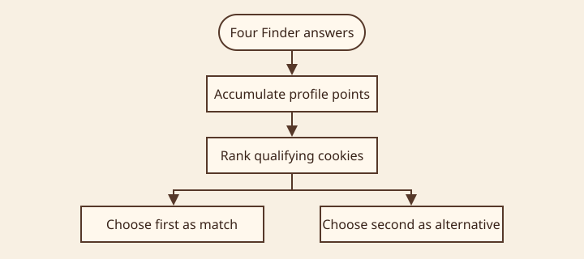

# Cookie Finder decision model

The decision helps a user locate a cookie using four taste answers. The rule-based Finder awards exactly three points to the primary catalogue ID and one point to the secondary ID for each answer.

| Answer code | Primary ID (+3) | Secondary ID (+1) |
| --- | ---: | ---: |
| chocolate | 2 | 1 |
| sweet | 3 | 6 |
| balanced | 5 | 1 |
| adventurous | 4 | 6 |
| classic | 1 | 3 |
| cookies-and-cream | 6 | 4 |

Rank positive totals in descending order, breaking ties by ascending ID. The first result is the recommendation and the second is the alternative. An empty input falls back to ID 1 with no alternative. Answer labels are shown in the Passport and the existing explanation favours the answer codes that gave the winner primary points. This is deterministic recommendation logic. Watermelon is a separate assistant.

| Decision | Source | Evidence |
| --- | --- | --- |
| Interpret answers and assign points | [Finder](../../../src/lib/cookie-finder.ts) | [Finder unit tests](../../../tests/site/cookie-finder.test.ts) |
| Rank, choose first and choose second | [Finder](../../../src/lib/cookie-finder.ts) | [256-combination Passport verification](../../../tests/site/cookie-shop-experience.test.ts) |
| Map result to editorial profile | [Passport labels](../../../src/lib/cookie-passport.ts) | Six reachable profiles in the same unit suite |

The [DMN file](cookie-finder.dmn) documents the same decisions using FEEL expressions. The XML was validated against the OMG DMN 1.3 schema. The 256 combination test exercises TypeScript. No DMN runtime is used and executable equivalence is unverified. [OMG DMN 1.3](https://www.omg.org/spec/DMN/1.3/)
