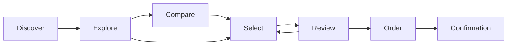

# Customer journey map

Potential difficulties describe hypotheses, not observed user feedback.

| Phase | Goal and touchpoint | Need or potential difficulty | Implemented response | Candidate measure |
|---|---|---|---|---|
| Discover | Choose a route from the homepage | Too many equally prominent actions | Direct ordering and optional discovery tools | Time to first relevant click |
| Explore | Learn about flavours through catalogue or Finder | Too much information to remember | Catalogue and short reason for a recommendation | Ability to describe two flavours |
| Compare | Evaluate products side by side | Differences are hard to scan | Aligned characteristics with optional highlighting | Comparison completion |
| Select | Add items or fill a box | Losing track of selections | Four individually editable slots with a live count and total | Replacement errors |
| Review | Correct the basket | Losing work while browsing | Shared basket, editable rows and prices | Correct quantity after editing |
| Order | Submit fictional details | Invalid input or repeated submission | Labelled inputs, review and idempotent server save | Time, errors and completion |
| Confirmation | Verify what was saved | Hard to identify reference or amount | Printable confirmation with saved reference and prices | Find the reference and total |

Users can skip Finder and comparison and go straight to ordering.
